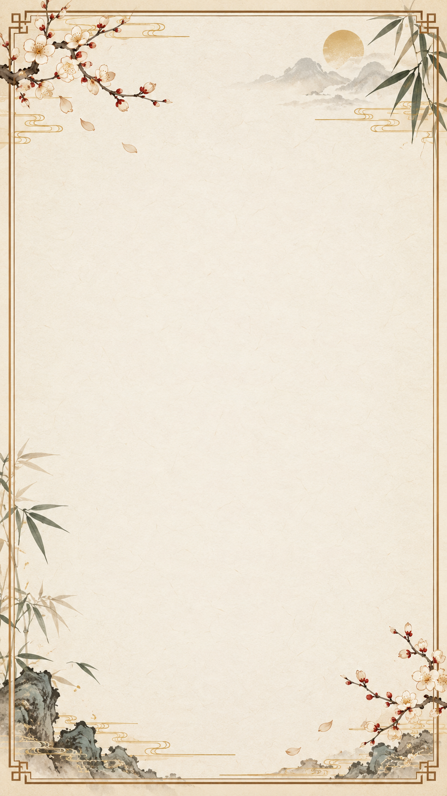

# 日报主题制作格式

麦麦小秘书的日报由**文字模型写摘要、本地程序把文字排入底图**。底图只负责装饰，不需要图片生成模型。插件配置页的「日报图片主题」可选 `azure`（原 Azure 主题）、`letter`（通用古风信笺）或 `custom`（自制底图）；已有安装默认仍选 `azure`。



## 自制底图文件

| 项目 | 要求 |
| --- | --- |
| 文件名 | `daily_report_theme.png`，固定名称，无须另写 JSON |
| 格式 | PNG，RGB 或完全不透明的 RGBA；不要使用透明背景 |
| 方向与比例 | 竖版 9:16，宽高比误差不超过 0.002 |
| 推荐尺寸 | 936 × 1664 像素；也接受宽 900–2000、高 1600–3600 像素的同等比例图片 |
| 大小 | 不超过 8 MiB |
| 文字颜色 | 自制主题固定使用深灰色 `#333333`，请让文字区保持浅色、低纹理、高对比度 |
| 最终成品 | 插件会统一输出 936 × 1664 像素 PNG |

以下位置由插件写字，以**底图宽、高的百分比**计算；作图时请留白，不要预先印上标题、日期或正文：

| 区域 | 位置与留白要求 |
| --- | --- |
| 标题「今日日报」 | 水平居中，顶端约在高度 16.5%；周围留出宽 35%–65%、高 14%–22% 的干净区域 |
| 日期 | 左边界为宽度 12%，顶端为高度 23.5%；留出宽 12%–89%、高 23%–29% 的干净区域 |
| 日报正文 | 左右为宽度 12%–89%，上边界约高度 29.5%，下边界高度 89%；整块区域尽量保持均匀浅色，装饰只放边框或四角 |

以推荐的 936 × 1664 像素为例，正文安全区约为 **x=112–833、y=491–1481**。正文会自动换行并在有限范围内缩小字号；仍放不下时会报错，**不会悄悄裁掉文字**。古风信笺底图位于 [`assets/letter_theme.png`](../assets/letter_theme.png)，可作为留白布局参考。

## 预览与启用

作好图片后，先在本地仓库运行预览脚本。它会检查格式，并生成一张带示例文字的成品图：

```powershell
.\.venv\Scripts\python.exe scripts\preview_report_theme.py 'C:\path\to\daily_report_theme.png'
```

确认文字清楚且没有压到装饰后，把图片放入 MaiBot 为本插件分配的**数据目录**，名称保持 `daily_report_theme.png`。这份图片放在数据目录而非插件代码目录，更新插件时更容易保留。通用位置为：

```text
<MaiBot 安装目录>/data/plugins/worldcopyist.mai-secretary/daily_report_theme.png
```

然后在 MaiBot 的麦麦小秘书插件配置页，把「日报图片主题」改为 `custom` 并保存。需要切回原图时选 `azure`，需要通用古风图时选 `letter`。这是插件的全局设置，影响之后生成的定时日报和管理员即时日报；已经发出的图片不会改变。

复制图片前请确认你使用的是当前 MaiBot 实例的插件数据目录。**不要覆盖服务器插件的 `config.toml` 或现有状态文件。**
